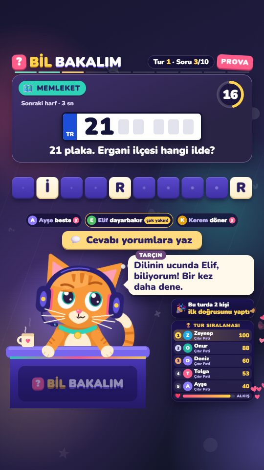
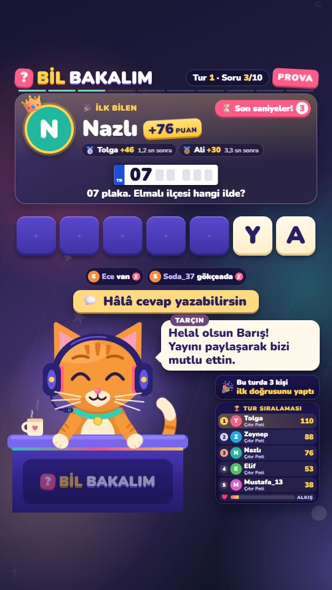

# Live Quiz Host

A quiz show that runs itself on a live stream.

An animated host reads a clue aloud, letters open one by one, viewers type the answer in the chat, and the first correct
answer wins the question. The host greets people by name, answers chat messages by voice, announces winners, and keeps
the show moving through rounds, podiums and breaks with no operator.

The show's content is Turkish. It is called *Bil Bakalım* ("go on, guess") and its host is a cat named Tarçın.

<p>
  
  
</p>

*Rehearsal mode with a simulated audience.*

## What is in here

| Part | Where | In one line |
|---|---|---|
| Game engine | `server/engine.js` | A state machine with no I/O: phases, timers, letters, scoring |
| Speech director | `server/host.js` | Decides what the host says next and makes sure it is never silent |
| Voice | `server/tts.js` | Local neural Turkish voice with a cache, fallbacks and worker restarts |
| Chat replies | `server/ai.js` | One-sentence answers from Claude, vetted before they are spoken |
| Event sources | `server/sources/` | Simulated audience; a custom chat source plugs in as a module |
| Stage | `public/` | One page over WebSocket, 1080×1920, with an SVG character |
| Content | `server/data/` | 1,042 questions and 630 host lines |

The design decisions are written up in [docs/ARCHITECTURE.md](docs/ARCHITECTURE.md) and the message formats in
[docs/PROTOCOL.md](docs/PROTOCOL.md).

## Run it

Needs Node 22 or newer.

```
npm install
npm run demo
```

Then open `http://localhost:8181/stage` for the show and `http://localhost:8181/panel` for the operator panel. Demo mode
fills the chat with a simulated audience, so the show plays by itself. On Windows, `PROVA.bat` does the same and opens
both pages.

**Voice.** Out of the box the host speaks through the Windows built-in Turkish voice if it is installed, and otherwise
shows subtitles with a short synthesized meow. For the voice used on air, run `POCKET_SES_KUR.bat` once: it installs
[Pocket TTS Turkish](https://huggingface.co/wite-tech/pocket-tts-turkish) into `data/` (needs Python 3.10 or newer, runs
on CPU).

**Chat replies.** Set `ANTHROPIC_API_KEY` to let the host answer free-form chat with Claude. Without it the host uses its
built-in replies only.

## Connect a real chat

The show knows events, not platforms: `join`, `chat`, `like`, `follow`, `share` and `viewers`.

- Post events to `POST /api/sim`, or
- write a source module and start with `SHOW_SOURCE=./my-source.js npm start`.

A source module exports `createSource({ onEvent, onStatus })` and returns `{ connect(), disconnect() }`. If a chat event
carries the platform's own timestamp (`at`), near-simultaneous answers are ranked by it instead of by arrival order. The
event format is in [docs/PROTOCOL.md](docs/PROTOCOL.md).

## On air

The show ran on a live stream with real audiences on 20 November 2026. The numbers below are per-minute aggregates from
the show's own journal ([data](docs/metrics/2026-11-20.json)); they contain no usernames or message text. The chat
connector used for those sessions is not part of this repository.


| Session | Minutes | Peak viewers | Chat messages | Questions solved | Host lines | Lines without voice |
|---|---:|---:|---:|---:|---:|---:|
| 11:59–12:42 | 44 | 378 | 1,887 | 89 | 604 | 10 |
| 13:08–14:33 | 86 | 233 | 4,057 | 189 | 1,181 | 10 |
| 15:20–16:46 | 87 | 109 | 4,051 | 180 | 1,179 | 33 |
| 19:05–19:17 | 13 | 9 | 112 | 17 | 137 | 1 |
| 19:27–20:16 | 50 | 5 | 297 | 85 | 549 | 1 |
| 21:18–21:33 | 16 | 124 | 629 | 30 | 210 | 0 |
| **Total** | **296** | | **11,033** | **590** | **3,860** | **55** |

Two things in the code come straight from those sessions:

- **Photo finish.** Viewers complained that the wrong person was named first. Chat arrives in batches, so ranking by arrival
  order could swap two answers half a second apart. The engine now waits 0.8 s after the first correct answer and ranks by
  the platform's timestamps.
- **Never silent.** Speech synthesis is slower than a fast chat. The director starts synthesizing a line the moment it is
  queued, speaks whichever line is ready, and falls back to pre-rendered clips before it falls back to subtitles. Across
  the day 1.4% of lines went out without voice.

## Tests

```
npm test
```

The suite uses Node's built-in test runner. The engine and the director run against an injected clock, the voice module
against fake worker processes, and one test boots the real server in demo mode.

## Credits

- Voice clips in `public/` were generated with Pocket TTS Turkish by Wite Tech (CC BY 4.0), which is derived from Pocket TTS
  by Kyutai. The voices are synthetic.
- The interface font is Nunito (SIL Open Font License 1.1); the licence text is in `public/assets/fonts/`.
