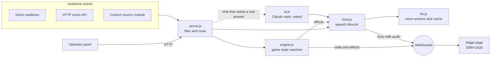

# Architecture

This document explains how the show is put together and why. The message formats are in [PROTOCOL.md](PROTOCOL.md).

## The shape of it

`server.js` is the only file that knows about the network, the disk and the clock. Everything it wires together takes its
dependencies as arguments, which is what lets the tests drive the engine and the director with a fake clock, a fake voice
and a seeded random source.

| Module | Role | Touches I/O |
|---|---|---|
| `engine.js` | Phases, timers, letters, scoring, ranking | No |
| `host.js` | Decides what the host says, in which order, with which audio | Only through the injected voice |
| `tts.js` | Turns a line into a cached WAV, across four providers | Worker processes, disk cache |
| `ai.js` | One-sentence chat replies from Claude, vetted before use | Anthropic API |
| `questions.js`, `normalize.js` | Question bank loading, round plan, answer judging | Reads the bank once |
| `players.js`, `journal.js` | Returning players, per-minute counters | Small JSON files under `data/` |
| `sources/demo.js` | Simulated audience | No |

## The game engine

The engine is a state machine advanced by `tick(dt)`. It never reads the clock; the server tells it how much time passed.

| Phase | Default length | What happens |
|---|---|---|
| lobby | 30 s | The host introduces the show and the rules |
| intro | 2.5 s | Category card for the next question |
| ask | up to 35 s | Clue on screen; first letter opens at 7 s, then one every 5 s |
| solved | 0.8 s + 5 s + 4.5 s | Photo finish, grace window for 2nd and 3rd, then the answer is revealed |
| timeout | 5 s | Nobody got it; the answer is shown |
| podium | 12 s | After 10 questions: round standings and champion |
| break | 40 s | The host asks the chat a question and reads answers back |

Rules worth knowing:

- **Scoring.** The first correct answer earns `max(30, 100 − 12 × open letters)`. Second place gets 60% of that, third 40%,
  anyone else who answers inside the grace window gets 10. A streak of three or more adds 20%. The tenth question of a
  round is worth double.
- **Letters.** At least 30% of the letters never open on their own, so waiting is never enough to win.
- **A round** follows a fixed plan of question types (plain words, licence-plate cities, a scrambled word, a proverb with a
  missing word, an emoji riddle) with rising difficulty.
- **The answer stays on the server.** The state sent to the stage contains the clue and the open letters only. The full
  answer leaves the server only when the question is over: when the grace window closes, or when time runs out. Reading
  the page source or the WebSocket while a question is open does not help anyone.

## Photo finish: who was really first

The first live sessions produced a steady complaint: "I wrote it first and it did not count."

Part of that cannot be fixed. Every viewer sees the stream with a different delay, and their own comment appears on their
screen instantly, so everyone believes they were first. The other part was ours. Chat arrives in batches with variable
network delay, and ranking by arrival order at our server could swap two people who answered within half a second.

The engine now handles the first correct answer like this:

1. When the first correct answer arrives, a 0.8 s window opens instead of declaring a winner.
2. Every correct answer that arrives inside the window is collected with the timestamp the *platform* assigned to it
   (`at`, milliseconds), not the time it reached us.
3. When the window closes the answers are sorted by that timestamp. If any answer lacks a timestamp, arrival order is used
   for all of them, so mixed data never produces a worse result than before.
4. Letters do not open and the question cannot time out while the window is open. The winner's score uses the number of
   letters open when the first answer arrived.

The winner card then shows how far behind second and third place were ("0,5 sn sonra"), and the host explains the stream
delay in one sentence when someone objects. The fix does not remove the perception problem. It makes the rule visible.

## The speech director

A host that goes quiet is worse than one that is occasionally wrong, and synthesis takes time. The director's job is to
make sure something sensible is always being said.

- **One line at a time, by priority.** Every line has a priority (1 to 5) and a time to live. The winner's name and the
  clue are priority 5; a greeting is 2. A line that expires in the queue is dropped; the stage still shows the visual.
- **Synthesis starts when a line is queued, not when it is its turn.** By the time the host is free, the audio is usually
  ready. The next clue is synthesized while the current question is still being played.
- **Speak what is ready.** When the host becomes free, the best line whose audio is *ready* is spoken. A higher-priority
  line that is still synthesizing gets a short budget (about 1.2 s for a winner announcement, 2 s for a clue, 2.5 s
  otherwise) before something else goes first.
- **Silence is the last resort.** If a line's own audio does not make it, the director falls back in order: a pre-rendered
  short clip for that kind of line, the same sentence with a generic form of address, and only then a subtitle with no
  voice. The stage plays a short synthesized "meow" under voiceless subtitles so the host never looks frozen.
- **Winner names are split.** "Ayşe got it!" is a very short line that synthesizes in well under a second, followed by a
  pre-rendered "last seconds" line. One long sentence was regularly late; two short ones are not.
- **No repeats.** Each kind of line remembers which variants it used recently.

In the live sessions on 20 November 2026 the host spoke 3,860 lines; 55 of them (1.4%) went out without voice.

## Voice

`tts.js` hides four providers behind one `speak(text)` call that never throws:

| Provider | What it is | When it is used |
|---|---|---|
| `pocket` | Pocket TTS Turkish, a local neural model on CPU, kept alive as a Python worker | Default when installed |
| `azure` | Azure neural voice | Only if a key and region are set in the environment |
| `local` | The Turkish voice built into Windows, kept alive as a PowerShell worker | Fallback while the neural worker is down |
| `off` | No synthesis | Tests, or by choice |

Details that mattered in practice:

- Audio is cached on disk by a hash of provider, voice, emotion and text, with a cap on the number of files. Lines without
  variables are synthesized in the background at start-up.
- If the neural worker crashes it is restarted with increasing delays (5 s, 15 s, 60 s, 120 s). Live lines switch to the
  Windows voice in the meantime and switch back when the worker returns.
- Requests carry a priority and can be cancelled; a line that leaves the queue stops occupying the worker.
- Worker processes receive a scrubbed environment. API keys and unrelated variables are not passed to them.

## Chat replies from Claude

Most chat is handled without a model: answers are judged by string distance, and a small intent matcher covers greetings,
"how do I play", "are you a bot" and similar with canned lines. Claude is called only when a viewer addresses the host
directly or answers the host's question during a break.

- The viewer's text is sent as data inside the user turn. The system prompt is fixed, which keeps it cacheable and means
  nothing a viewer writes becomes an instruction.
- The model is never given the open question's answer.
- Output is vetted before it is spoken: at most 140 characters, no blocked words, and nothing that asks viewers for money,
  rewards or follows. A reply that fails is dropped silently.
- Calls are rate limited (one every 25 s by default) and the key is checked once at start-up so the panel can show whether
  chat is actually connected.
- Without a key the feature is simply off and the show runs on canned replies.

## What viewers can make the host say

Reading viewer text aloud on a live stream is a risk, so the rules are narrow:

- A viewer's name is spoken only if it is pronounceable and not blocked; otherwise a nameless variant of the line is used.
- A viewer's words are echoed only when every word is on an allow-list built from the question bank's answers, province
  names and a small curated list. Anything else gets a name-only acknowledgement.
- Guesses shown on screen must look like guesses, and a separate filter keeps sensitive topics off the screen.

## Events in, no platform inside

The show does not know any chat platform. It knows six event types (`join`, `chat`, `like`, `follow`, `share`,
`viewers`). They can come from the built-in demo audience, from HTTP posts to `/api/sim`, or from a source module
loaded with `SHOW_SOURCE`. A source exports `createSource({ onEvent, onStatus })` and returns `{ connect, disconnect }`.
When a source reports `connected` for the first time the show restarts from its opening, because until that moment
nobody was watching.

## State on disk

Everything under `data/` is local and ignored by git: the voice cache, settings, the list of recently used questions,
returning players (nickname and counts only) and the journal. The journal writes one JSON line per event and a counter
summary per minute. It records nicknames for a few events (a follow, a round champion). Ordinary chat is only counted;
the one piece of viewer text it keeps is the message that triggered a model reply, stored next to the reply.
`tools/yayin-verisi.mjs` exports a day as per-minute aggregates with no names, which is where the numbers in the README
come from.

## Tests

`npm test` runs the suite with Node's built-in test runner; there is no test framework dependency. The engine and the
director are tested with an injected clock and random source. The voice module is tested against fake worker processes,
including crashes, timeouts and restarts. One test boots the real server in demo mode on a free port and exercises the
HTTP API. A lint-style test scans every host line and every question for wording that asks viewers for money or rewards.

## Known limits

- The server is a single process with in-memory show state. A restart begins a new show; scores do not survive it.
- The panel has no authentication. The server binds to localhost by default, and in LAN mode other devices can only read
  the stage. The POST endpoints do not check the request origin, apart from the one that accepts an API key.
- The voice fallbacks are Windows-specific. On other systems the choices are the local neural model or subtitles.
- The question bank was written with AI assistance and spot-checked, not fully reviewed by a person. Expect the occasional
  debatable clue.
